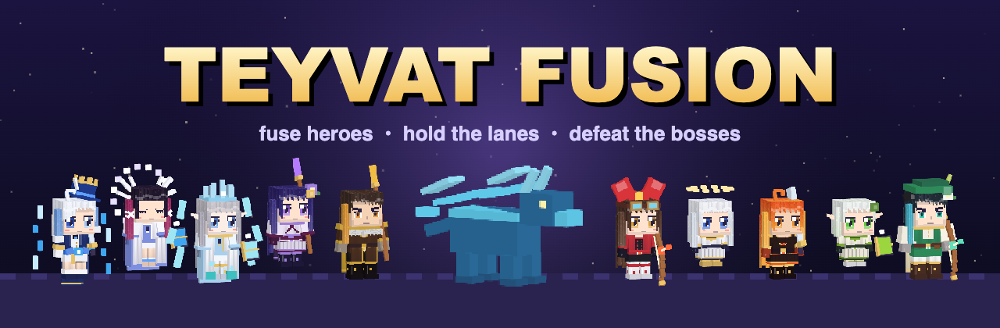
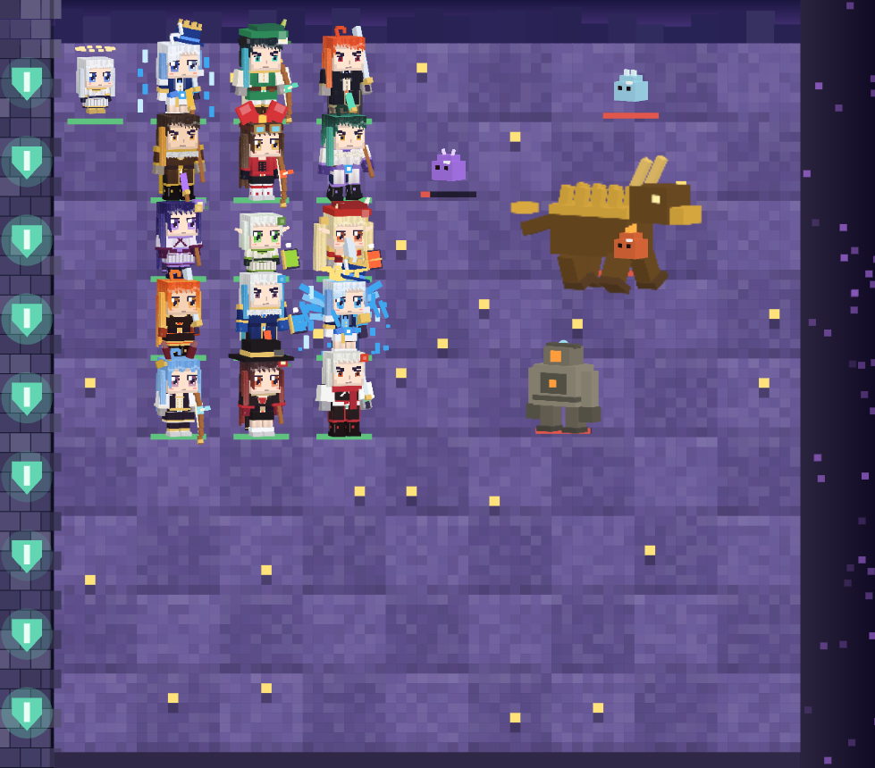
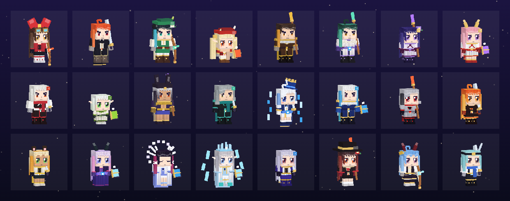
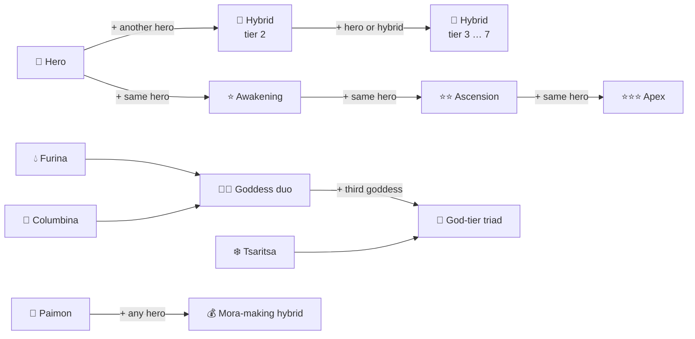
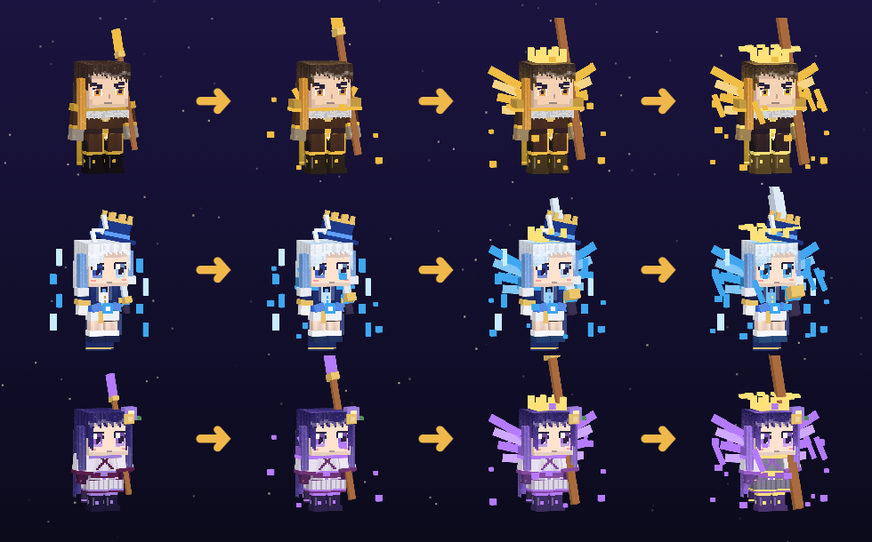
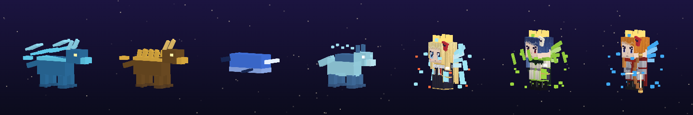
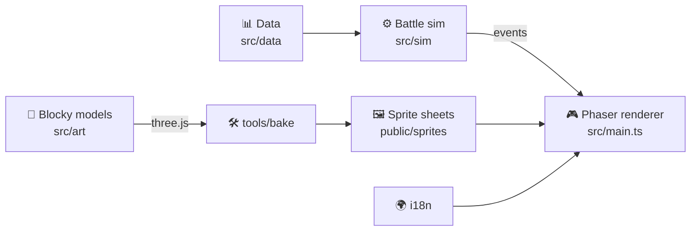

<div align="center">



# ⚔️ Teyvat Fusion

**A fan-made lane-defense game where you fuse Teyvat's heroes into ever stranger and stronger hybrids.**

*Plant your heroes. Merge them. Ascend them. Hold the line against hilichurls, abyss mages and dragons.*

[](https://www.typescriptlang.org/)
[](https://phaser.io/)
[](https://vitejs.dev/)
[](tests)
[](src/i18n/langs.ts)
[](LICENSE)

<a href="https://tashtemirlan.github.io/teyvat-fusion/"></a>

**English** · [Русский](README.ru.md)

[✨ Features](#-features) · [🧬 Fusion](#-how-fusion-works) · [🐉 Bosses](#-bosses) · [🚀 Quick start](#-quick-start) · [🎮 Controls](#-controls) · [🗂 Project](#-project-structure)

</div>

---

<div align="center">

<br><sub><i>Endless mode: five lanes of heroes against Azhdaha and his escort.</i></sub>
</div>

## ✨ Features

<table>
<tr>
<td width="50%" valign="top">

### 🧬 Fusion everywhere
Drop one hero onto another and they **merge into a hybrid** with new stats, new looks and new tricks. Hybrids fuse further, up to **tier 7** and beyond.

### 🌟 Ascensions
Every attacker can be ascended **up to 4×**. Each step adds wings, weapon rings, armor plates and halos, so it looks cooler every time.

### 🌙 Goddesses and god tier
**Furina** drowns the field in a waterfall. **Columbina** summons the moon. **The Tsaritsa** brings a blizzard. Fuse all three into **god-tier triads** with field-wide attacks.

</td>
<td width="50%" valign="top">

### 🗺 A whole Teyvat campaign
**9 regions** from Mondstadt to Snezhnaya and beyond, over **100 days** of story levels, with day and night battles.

### ♾ Endless mode
Every hero and every hybrid is unlocked. Waves get **bigger, not tankier**: enemy HP never scales, only their numbers grow. Every 5th wave brings bosses.

### 📖 Almanac
**1,000+ entries**: heroes, hybrids, ascensions, Paimon combos and 397 enemies. Open it **mid-battle** (`A`) and the game pauses for you.

</td>
</tr>
</table>

<div align="center">

| 🦸 Heroes | 🧪 Hybrids | 🌟 Ascensions | 🍞 Paimon combos | 👑 Goddesses & god tier | 👹 Enemies |
|:---:|:---:|:---:|:---:|:---:|:---:|
| **123** | **130** | **369** | **128** | **30** | **397** |

</div>

<div align="center">

<br><sub><i>Every figure is a hand-built blocky voxel model, rendered into sprites by the game itself.</i></sub>
</div>

## 🧬 How fusion works



- 🖱 **Hover any hero** to see its stats **and every recipe it can go into next**.
- 🧤 **The glove** (`G`) lets you drag a unit onto another one and fuse them right on the field.
- ❓ Unknown recipes show up as **"something new"**. Discover them yourself, and the almanac remembers.

<div align="center">

<br><sub><i>Base hero → Awakening → Ascension → Apex.</i></sub>
</div>

## 🐉 Bosses

Bosses walk the lanes like everyone else, but each one has **its own HP and its own special attacks and debuffs**. Hover any enemy to see its name, health bar and abilities.

<div align="center">

</div>

<div align="center">

| Boss | ❤️ HP | Signature moves |
|:--|--:|:--|
| 🌪 Stormterror | 14 000 | Gust pushes heroes back · lightning strikes |
| 🐺 Lupus Boreas | 12 000 | Summons rifthounds · freezes a lane |
| 🌊 Childe | 16 000 | Burns a lane · **enrages** at 50% HP |
| 🪨 Azhdaha | 22 000 | Earthquakes across lanes · stone shield |
| ❄️ La Signora | 18 000 | Freezes three lanes · enrages |
| ⚡ Magatsu Mitake Narukami | 20 000 | Five-bolt thunder barrage |
| 🎭 Shouki no Kami | 17 000 | Shield · lightning strikes |
| 🌵 Guardian of Apep's Oasis | 26 000 | Heals itself · summons dendro slimes |
| 🐋 All-Devouring Narwhal | 24 000 | **Swallows a hero whole** |
| 🔥 The Knave | 21 000 | Burns lanes · enrages |
| 🌋 Lord of Eroded Primal Fire | 25 000 | Burns lanes · earthquakes |
| 🚪 The Game Before the Gate | 19 000 | Summons an army · shield |
| 🧪 The Doctor | 23 000 | Summons Fatui · heals |
| 💀 Il Dottore | 27 000 | Heavy strikes · enrages at 40% |

</div>

> [!TIP]
> Shielded bosses take **no damage** until the shield drops. Save your burst for when it fades. 🛡

## ⚗️ Elemental reactions

Heroes apply elements, and the elements react: **Melt · Vaporize · Overload · Superconduct · Electro-Charged · Frozen · Burning · Bloom · Quicken · Swirl · Crystallize**.

<div align="center">

🔥 Pyro · 💧 Hydro · 🌪 Anemo · ⚡ Electro · 🌿 Dendro · ❄️ Cryo · 🪨 Geo

</div>

## 🌍 52 languages

The whole interface is translated, and it picks your browser's language on first launch. Switch it anytime in the main menu.

> 🇬🇧 English · 🇷🇺 Русский · 🇨🇳 简体中文 · 🇹🇼 繁體中文 · 🇯🇵 日本語 · 🇰🇷 한국어 · 🇻🇳 Tiếng Việt · 🇹🇭 ไทย · 🇮🇩 Indonesia · 🇲🇾 Melayu · 🇵🇭 Filipino · 🇮🇳 हिन्दी · 🇧🇩 বাংলা · 🇵🇰 اردو · தமிழ் · తెలుగు · मराठी · 🇸🇦 العربية · 🇮🇷 فارسی · 🇮🇱 עברית · 🇹🇷 Türkçe · 🇩🇪 Deutsch · 🇫🇷 Français · 🇪🇸 Español · 🇵🇹 Português · 🇮🇹 Italiano · 🇳🇱 Nederlands · 🇵🇱 Polski · 🇺🇦 Українська · 🇨🇿 Čeština · 🇸🇰 Slovenčina · 🇭🇺 Magyar · 🇷🇴 Română · 🇧🇬 Български · 🇬🇷 Ελληνικά · 🇸🇪 Svenska · 🇳🇴 Norsk · 🇩🇰 Dansk · 🇫🇮 Suomi · 🇪🇪 Eesti · 🇱🇻 Latviešu · 🇱🇹 Lietuvių · 🇷🇸 Српски · 🇭🇷 Hrvatski · 🇸🇮 Slovenščina · 🇰🇿 Қазақша · 🇺🇿 Oʻzbekcha · 🇦🇿 Azərbaycanca · 🇰🇪 Kiswahili · 🇿🇦 Afrikaans · Català · 🇬🇪 ქართული

Right-to-left scripts (Arabic, Persian, Hebrew, Urdu) are laid out right to left. Translations into less common languages may be imperfect, and pull requests are welcome. 🙏

## 🚀 Quick start

### ▶ Play online

**[https://tashtemirlan.github.io/teyvat-fusion/](https://tashtemirlan.github.io/teyvat-fusion/)**. No install needed: it runs in any modern browser, and your progress is saved locally.

### 🛠 Run locally

You need **Node.js 20+**.

```bash
git clone https://github.com/tashtemirlan/teyvat-fusion.git
cd teyvat-fusion
npm install
npm run dev
```

> [!TIP]
> Sprites in `public/sprites/` are rendered by the game itself from its blocky models. If you change a model in `src/art`,
> open **http://localhost:5173/tools/bake.html** while `npm run dev` is running to re-render them.

Then open **http://localhost:5173** and play. 🎉

| Command | What it does |
|:--|:--|
| `npm run dev` | Dev server with hot reload |
| `npm test` | Runs the 60 battle and localization tests |
| `npm run build` | Type-checks and builds into `dist/` |

Every push to `main` is tested, built and deployed to GitHub Pages automatically by [`.github/workflows/deploy.yml`](.github/workflows/deploy.yml).

## 🎮 Controls

<div align="center">

| Key | Action |
|:--:|:--|
| 🖱 **Left click** | Pick a hero card, then click a cell to place it |
| 🖱 **Right click** / `Esc` | Cancel the selection |
| `G` | 🧤 Glove: drag a unit to move or fuse it |
| `S` | 💰 Sell a unit for 60% of its cost |
| `Space` | ⏸ Pause |
| `A` | 📖 Almanac (pauses the battle) |

</div>

## 🗂 Project structure

```text
teyvat-fusion/
├── 🎮 src/
│   ├── main.ts           # Phaser scene, menus, HUD, almanac
│   ├── sim/battle.ts     # pure battle simulation, no rendering
│   ├── data/             # heroes, recipes, levels, bosses, English names
│   ├── art/              # blocky voxel models for heroes and enemies
│   ├── i18n/             # 52 languages and the t() helper
│   └── save.ts           # local saves, export and import
├── 🛠 tools/bake.*       # renders every model into sprite sheets (three.js)
├── 🧪 tests/             # Vitest: battle rules, bosses, endless mode, dictionaries
└── 📄 index.html
```



The battle simulation knows nothing about rendering, so the rules are fully covered by fast unit tests.

## ⚠️ Disclaimer

> [!NOTE]
> **Teyvat Fusion is an unofficial, non-commercial fan project.** It is not affiliated with, endorsed by or connected to HoYoverse / miHoYo.
> *Genshin Impact*, its characters, names and world are trademarks and property of **HoYoverse**.
> The game contains **no assets ripped from Genshin Impact**: every figure is an original blocky model built in code.
> The MIT license below covers **this project's source code only**, not HoYoverse's intellectual property.

## 📜 License

The code is released under the [MIT License](LICENSE) © 2026 Temirlan Tashtanov.

<div align="center">

---

Made with 💛 and way too many fusions.

**If you enjoyed it, drop a ⭐. Paimon will be pleased.**

</div>
