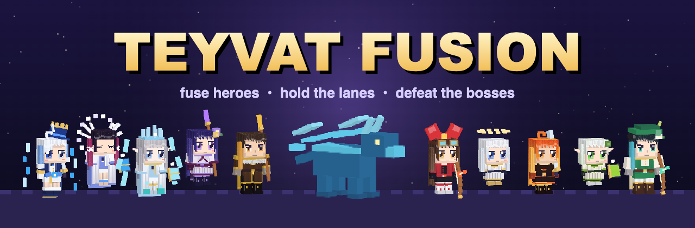
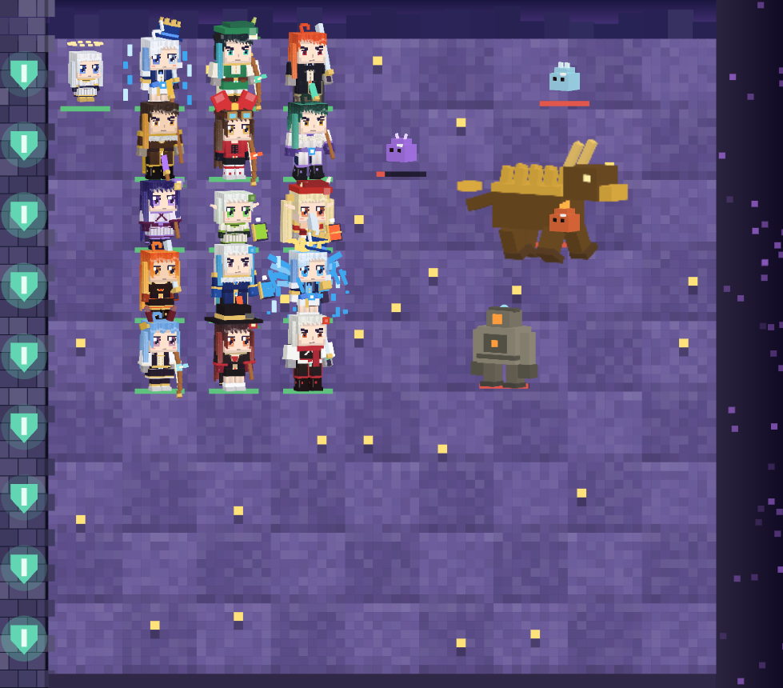
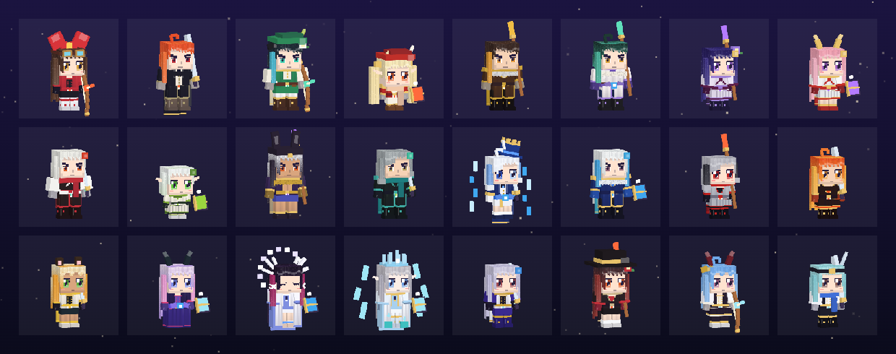
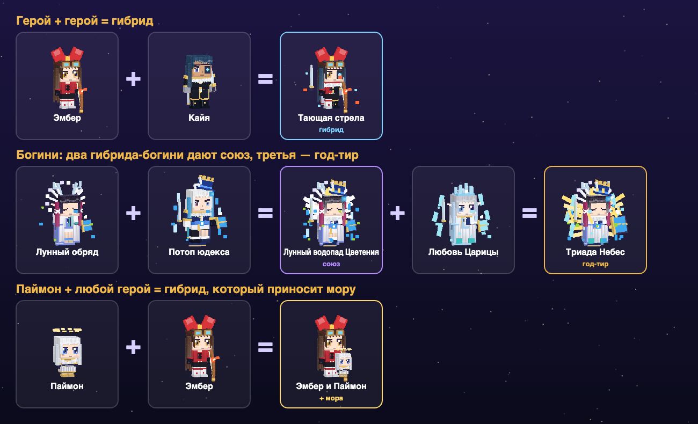
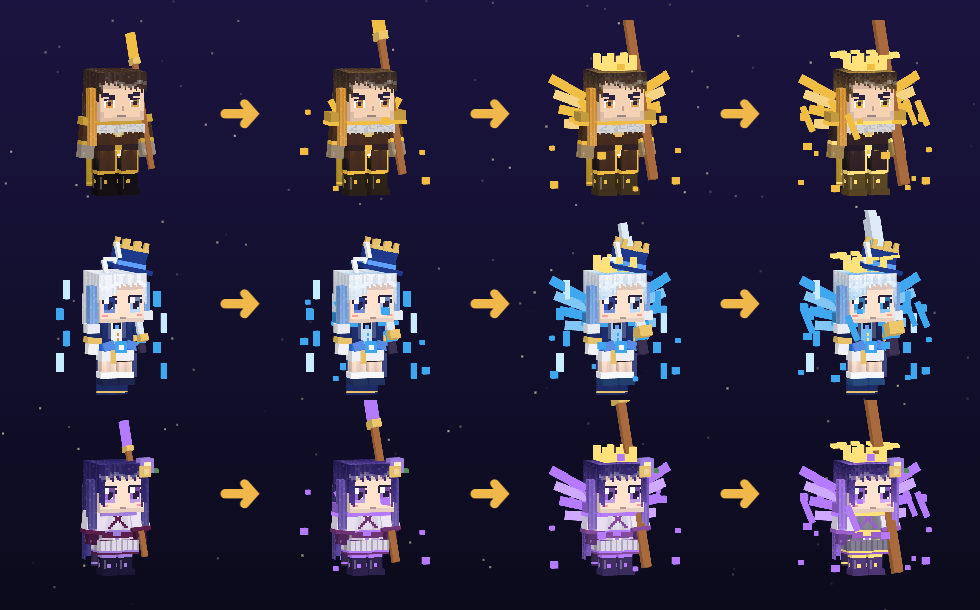
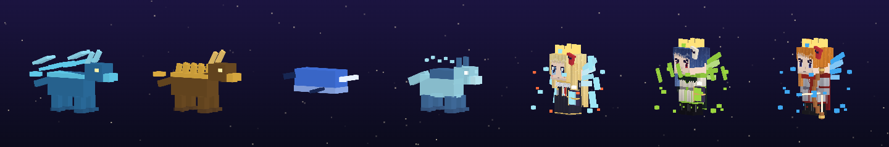

<div align="center">



# ⚔️ Teyvat Fusion

**Фанатский лайн-дефенс, где герои Тейвата скрещиваются во всё более странных и сильных гибридов.**

*Ставь героев. Скрещивай. Возвышай. Держи линии против хиличурлов, магов Бездны и драконов.*

[](https://www.typescriptlang.org/)
[](https://phaser.io/)
[](https://vitejs.dev/)
[](tests)
[](src/i18n/langs.ts)
[](LICENSE)

<a href="https://tashtemirlan.github.io/teyvat-fusion/"></a>

[English](README.md) · **Русский**

[✨ Возможности](#-возможности) · [🧬 Скрещивание](#-как-работает-скрещивание) · [🐉 Боссы](#-боссы) · [🚀 Запуск](#-быстрый-старт) · [🎮 Управление](#-управление) · [🗂 Проект](#-структура-проекта)

</div>

---

<div align="center">

<br><sub><i>Бесконечный режим: пять линий героев против Аждахи и его свиты.</i></sub>
</div>

## ✨ Возможности

<table>
<tr>
<td width="50%" valign="top">

### 🧬 Скрещивание
Поставь героя на другого, и они **сольются в гибрида**: новые характеристики, новый облик и новые приёмы. Гибриды скрещиваются дальше, вплоть до **7-й ступени** и выше.

### 🌟 Возвышения
Любого атакующего героя можно возвысить **до 4 раз**. С каждым шагом у него появляются крылья, кольца оружия, доспехи и нимб, и выглядит он всё круче.

### 🌙 Богини и год-тир
**Фурина** обрушивает на поле водопад. **Коломбина** призывает луну. **Царица** насылает снежную метель. Сведи всех трёх в **год-тир триады**, которые бьют по всему полю.

</td>
<td width="50%" valign="top">

### 🗺 Кампания по всему Тейвату
**9 регионов** от Мондштадта до Снежной и за её пределами, **больше 100 дней** сюжета, дневные и ночные бои.

### ♾ Бесконечный режим
Открыты все герои и все гибриды. Волны становятся **больше, а не толще**: здоровье врагов не растёт, растёт только их число. Каждая 5-я волна приводит боссов.

### 📖 Альманах
**Больше 1000 записей**: герои, гибриды, возвышения, связки с Паймон и 397 врагов. Открывается **прямо в бою** (`A`), игра при этом встаёт на паузу.

</td>
</tr>
</table>

<div align="center">

| 🦸 Герои | 🧪 Гибриды | 🌟 Возвышения | 🍞 Связки с Паймон | 👑 Богини и год-тир | 👹 Враги |
|:---:|:---:|:---:|:---:|:---:|:---:|
| **123** | **130** | **369** | **128** | **30** | **397** |

</div>

<div align="center">

<br><sub><i>Каждая фигурка — блочная воксельная модель, собранная в коде. Игра сама рендерит её в спрайты.</i></sub>
</div>

## 🧬 Как работает скрещивание

<div align="center">

</div>

- 🖱 **Наведи на героя**: увидишь его характеристики **и все рецепты, в которые он идёт дальше**.
- 🧤 **Перчатка** (`G`) позволяет перетащить юнита на другого и скрестить их прямо на поле.
- ❓ Неизвестный рецепт показывается как **«что-то новое»**. Открой его сам, и альманах запомнит.

<div align="center">

<br><sub><i>Герой → Пробуждение → Возвышение → Вершина.</i></sub>
</div>

## 🐉 Боссы

Боссы идут по линиям как обычные враги, но у каждого **своё здоровье и свои спецатаки и дебаффы**. Наведи курсор на любого врага, и увидишь его имя, полоску здоровья и способности.

<div align="center">

</div>

<div align="center">

| Босс | ❤️ HP | Коронные приёмы |
|:--|--:|:--|
| 🌪 Ужас Бури | 14 000 | Порыв отбрасывает героев · удары молний |
| 🐺 Андриус | 12 000 | Призывает разломных гончих · замораживает линию |
| 🌊 Тарталья | 16 000 | Поджигает линию · **звереет** на 50% HP |
| 🪨 Аждаха | 22 000 | Землетрясения по нескольким линиям · каменный щит |
| ❄️ Синьора | 18 000 | Замораживает три линии · звереет |
| ⚡ Магацу Митакэ Наруками | 20 000 | Шквал из пяти молний |
| 🎭 Сёки но Ками | 17 000 | Щит · удары молний |
| 🌵 Страж оазиса Апепа | 26 000 | Лечится · призывает дендро слаймов |
| 🐋 Всепожирающий нарвал | 24 000 | **Проглатывает героя целиком** |
| 🔥 Слуга | 21 000 | Поджигает линии · звереет |
| 🌋 Владыка первородного огня | 25 000 | Поджог линий · землетрясения |
| 🚪 Игра перед вратами | 19 000 | Призывает армию · щит |
| 🧪 Доктор | 23 000 | Призывает Фатуи · лечится |
| 💀 Иль Дотторе | 27 000 | Тяжёлые удары · звереет на 40% |

</div>

> [!TIP]
> Пока у босса висит щит, урон **не проходит**. Прибереги самые сильные удары до момента, когда он спадёт. 🛡

## ⚗️ Элементальные реакции

Герои накладывают элементы, и элементы реагируют друг с другом: **Таяние · Пар · Перегрузка · Сверхпроводник · Заряжен · Заморозка · Горение · Бутонизация · Стимуляция · Рассеивание · Кристаллизация**.

<div align="center">

🔥 Пиро · 💧 Гидро · 🌪 Анемо · ⚡ Электро · 🌿 Дендро · ❄️ Крио · 🪨 Гео

</div>

## 🌍 52 языка

Весь интерфейс переведён. При первом запуске игра берёт язык браузера, сменить его можно в главном меню в любой момент.

> 🇬🇧 English · 🇷🇺 Русский · 🇨🇳 简体中文 · 🇹🇼 繁體中文 · 🇯🇵 日本語 · 🇰🇷 한국어 · 🇻🇳 Tiếng Việt · 🇹🇭 ไทย · 🇮🇩 Indonesia · 🇲🇾 Melayu · 🇵🇭 Filipino · 🇮🇳 हिन्दी · 🇧🇩 বাংলা · 🇵🇰 اردو · தமிழ் · తెలుగు · मराठी · 🇸🇦 العربية · 🇮🇷 فارسی · 🇮🇱 עברית · 🇹🇷 Türkçe · 🇩🇪 Deutsch · 🇫🇷 Français · 🇪🇸 Español · 🇵🇹 Português · 🇮🇹 Italiano · 🇳🇱 Nederlands · 🇵🇱 Polski · 🇺🇦 Українська · 🇨🇿 Čeština · 🇸🇰 Slovenčina · 🇭🇺 Magyar · 🇷🇴 Română · 🇧🇬 Български · 🇬🇷 Ελληνικά · 🇸🇪 Svenska · 🇳🇴 Norsk · 🇩🇰 Dansk · 🇫🇮 Suomi · 🇪🇪 Eesti · 🇱🇻 Latviešu · 🇱🇹 Lietuvių · 🇷🇸 Српски · 🇭🇷 Hrvatski · 🇸🇮 Slovenščina · 🇰🇿 Қазақша · 🇺🇿 Oʻzbekcha · 🇦🇿 Azərbaycanca · 🇰🇪 Kiswahili · 🇿🇦 Afrikaans · Català · 🇬🇪 ქართული

Языки с письмом справа налево (арабский, персидский, иврит, урду) отображаются справа налево. Переводы на редкие языки могут быть неточными, поправки через pull request приветствуются. 🙏

## 🚀 Быстрый старт

### ▶ Играть онлайн

**[https://tashtemirlan.github.io/teyvat-fusion/](https://tashtemirlan.github.io/teyvat-fusion/)**. Ничего ставить не нужно: игра работает в любом современном браузере, прогресс сохраняется локально.

### 🛠 Запустить у себя

Нужен **Node.js 20+**.

```bash
git clone https://github.com/tashtemirlan/teyvat-fusion.git
cd teyvat-fusion
npm install
npm run dev
```

> [!TIP]
> Спрайты в `public/sprites/` игра рендерит сама из своих блочных моделей. Если поменяешь модель в `src/art`,
> открой **http://localhost:5173/tools/bake.html**, пока работает `npm run dev`, и спрайты перерендерятся.

Потом открой **http://localhost:5173** и играй. 🎉

| Команда | Что делает |
|:--|:--|
| `npm run dev` | Сервер разработки с горячей перезагрузкой |
| `npm test` | 60 тестов боя и локализации |
| `npm run build` | Проверка типов и сборка в `dist/` |

Каждый пуш в `main` автоматически проходит тесты, собирается и выкладывается на GitHub Pages через [`.github/workflows/deploy.yml`](.github/workflows/deploy.yml).

## 🎮 Управление

<div align="center">

| Клавиша | Действие |
|:--:|:--|
| 🖱 **Левый клик** | Выбрать карточку героя, затем клетку, куда его поставить |
| 🖱 **Правый клик** / `Esc` | Отменить выбор |
| `G` | 🧤 Перчатка: перетащить юнита, чтобы передвинуть или скрестить |
| `S` | 💰 Продать юнита за 60% вложенной моры |
| `Пробел` | ⏸ Пауза |
| `A` | 📖 Альманах (ставит бой на паузу) |

</div>

## 🗂 Структура проекта

```text
teyvat-fusion/
├── 🎮 src/
│   ├── main.ts           # сцена Phaser, меню, HUD, альманах
│   ├── sim/battle.ts     # чистая симуляция боя, без отрисовки
│   ├── data/             # герои, рецепты, уровни, боссы, английские имена
│   ├── art/              # блочные воксельные модели героев и врагов
│   ├── i18n/             # 52 языка и функция t()
│   └── save.ts           # локальные сохранения, экспорт и импорт
├── 🛠 tools/bake.*       # рендерит модели в спрайт-листы (three.js)
├── 🧪 tests/             # Vitest: правила боя, боссы, бесконечный режим, словари
└── 📄 index.html
```

<div align="center">

**🧱 Блочные модели** `src/art` → **🛠 Рендер** `tools/bake` → **🖼 Спрайт-листы** `public/sprites`

**📊 Данные** `src/data` → **⚙️ Симуляция боя** `src/sim` → *события* → **🎮 Отрисовка Phaser** `src/main.ts` ← **🌍 i18n** `src/i18n`

</div>

Симуляция боя ничего не знает об отрисовке, поэтому все правила покрыты быстрыми юнит-тестами.

## ⚠️ Дисклеймер

> [!NOTE]
> **Teyvat Fusion — неофициальный некоммерческий фанатский проект.** Он никак не связан с HoYoverse / miHoYo и не одобрен ими.
> *Genshin Impact*, его персонажи, имена и мир — товарные знаки и собственность **HoYoverse**.
> В игре **нет ассетов, вытащенных из Genshin Impact**: каждая фигурка — оригинальная блочная модель, собранная в коде.
> Лицензия MIT распространяется **только на исходный код проекта**, но не на интеллектуальную собственность HoYoverse.

## 📜 Лицензия

Код распространяется по [лицензии MIT](LICENSE) © 2026 Temirlan Tashtanov.

<div align="center">

---

Сделано с 💛 и слишком большим количеством скрещиваний.

**Понравилось? Поставь ⭐, Паймон будет довольна.**

</div>
